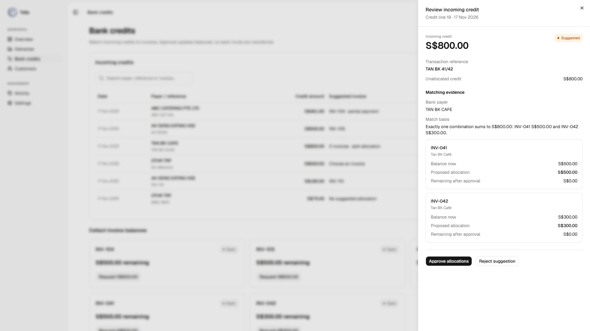
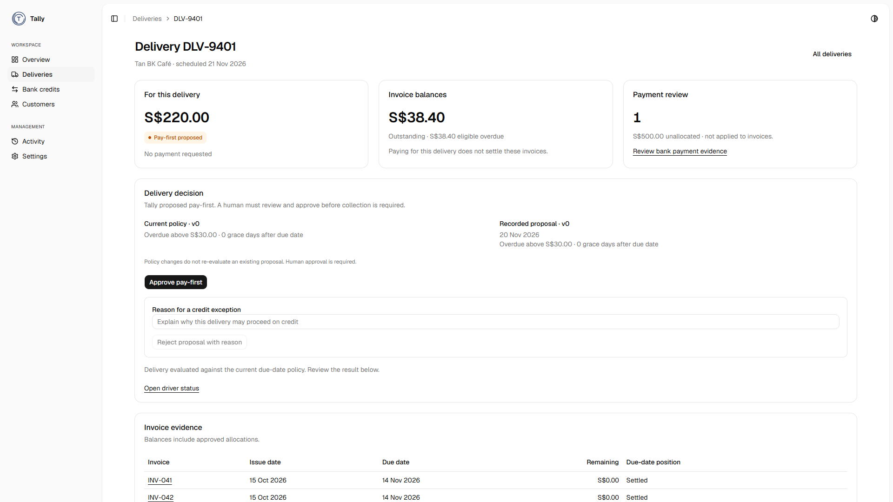
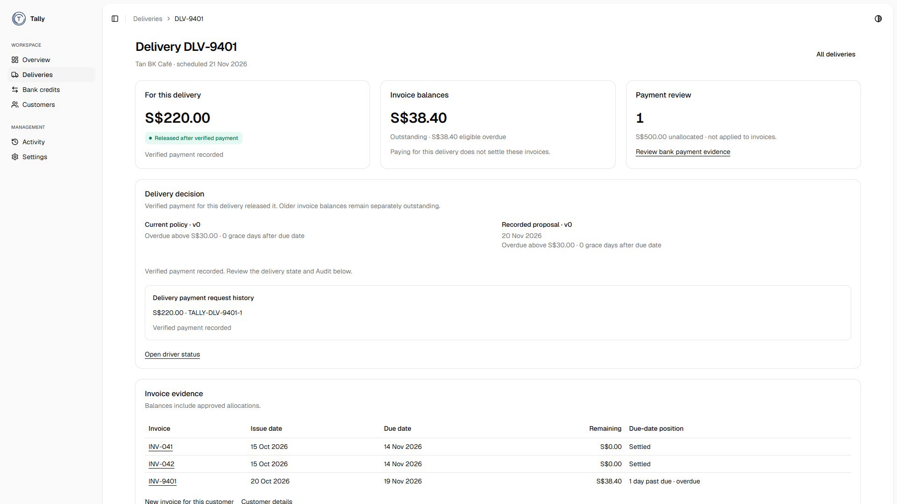

# Tally

Built for **Build Night**, a hackathon and demo showcase hosted by **HitPay**, with support from **Stripe** and **SpaceXSI**, focused on solving real problems for Singapore's small businesses.

Tally helps a supplier answer: **has this been paid, and should I deliver tomorrow?** It matches DBS bank-transfer exceptions to invoices, asks a person to approve allocations, collects exact remainders through HitPay, and proposes pay-first deliveries for overdue customers. Deterministic code decides money and holds; optional AI reads payment references. This is a sandbox hackathon project.

## How Tally works

The screenshots below show the actual application with fictional customers and sandbox data.

### 1. Review incoming payments

Import a bank statement and review suggested invoice matches. Here, one **S$800 transfer** covers two invoices: **S$500 and S$300**. Tally shows the proposed split and resulting balances; a person must approve before the allocation is applied.



### 2. Review the next delivery decision

The customer still has **S$38.40 overdue** and a new **S$220 delivery**. Tally proposes pay-first under the configured policy. The supplier reviews the invoice and uncertain payment evidence, then approves pay-first or records a credit exception. A proposal alone does not collect payment.



### 3. Confirm payment and release the order

HitPay collects **S$220 for this delivery**. Tally verifies the provider's payment record before marking it **Released after verified payment**. The older **S$38.40 invoice stays outstanding**; paying for the new order does not clear previous debt.



This workflow is implemented for the explicitly enabled local supplier demonstration. A real HitPay sandbox PayNow payment, provider confirmation through polling and delivery release were verified on 20 November 2026. Funds were simulated; production authentication and actual inbound webhook delivery remain outside the demonstrated scope. See the [recorded sandbox evidence](docs/verification.md#completed-sandbox-payment-and-release).

**Implemented:** upcoming delivery list/detail, invoice and delivery creation, due dates/grace periods, guarded older-reference matching, explicit credit decisions and verified fake-gateway and real sandbox payment/release paths. Legacy invoices retain unknown due dates and do not count toward automatic overdue proposals. **Remaining gaps:** actual inbound webhook delivery, provider-side recovery for unresolved creation, organiser eligibility and production authentication. See [verification](docs/verification.md#known-limitations) for the evidence limits and [features](docs/features.md) for current behavior.

## Build Night

The brief requires HitPay's MCP server and AI tooling, using Grok Bot or Grok Build. See [HitPay's Build with AI guide](https://docs.hitpayapp.com/apis/guide/build-with-ai). Using [Stripe through HitPay's Custom Payment Method connection](https://docs.hitpayapp.com/connections/stripe/overview) earns bonus points; **Stripe integration is not implemented in Tally**. Tally's current sandbox MCP integration and optional AI reference hints are described in [integrations](docs/integrations.md).

### Judging criteria

The Build Night brief names **technical depth, problem–solution fit and creativity**. The explanations below are our interpretation for Tally, not an official scoring rubric or published weighting.

| Criterion | What it likely means for Tally |
| --- | --- |
| **Technical depth** | Does the prototype genuinely work? Is HitPay integrated meaningfully? Are payments verified, reconciliation reliable and financial decisions handled correctly? |
| **Problem–solution fit** | Does it solve a real Singapore SME problem? Is the problem important, and does Tally address it effectively? |
| **Creativity** | Is there a distinctive approach beyond existing payment, invoicing or accounting software? |

Use these criteria to guide implementation and the demo; they are not claims that the current prototype already meets every requirement. [Verification](docs/verification.md#completed-sandbox-payment-and-release) records the demonstrated workflow, while [integration evidence and eligibility limits](docs/integrations.md#tooling-evidence-and-remaining-provider-proof) distinguishes it from organiser acceptance.

## Quickstart

Use Node.js **22.13+** with `node:sqlite` and `--env-file-if-exists` support (previously verified on 26.2), plus npm. Run commands from this directory.

```sh
npm install
```

For a fresh checkout, copy [`.env.example`](.env.example) to `.env`; keep any existing local configuration. For an isolated demo including Settings, use the [fake PowerShell preparation](docs/demo.md#prepare-a-browser-demonstration) or the [complete real HitPay sandbox workflow](docs/demo.md#real-hitpay-sandbox-workflow). Both launch normally:

```sh
npm run dev
```

Settings editing is available under normal `npm run dev` when the [disposable-ledger safeguards](docs/features.md#settings) pass, in explicit fake or real sandbox MCP mode. `TALLY_LOCAL_LEDGER_EDITS=on` is required for both Settings and supplier actions; there is no separate Settings-only opt-in. Sandbox credentials do not lock Settings. The real sandbox walkthrough uses actual checkout followed by polling, without a public callback or tunnel.

Open [127.0.0.1:43123](http://127.0.0.1:43123). The environment example selects real sandbox MCP and requires your sandbox API key and webhook salt; the fake preparation above needs neither. First access to an empty database installs the fictional demo world automatically. The default ledger is `data/tally.db`; verify `TALLY_DB_URL` before running commands and never reset an existing working ledger. See [database initialization](docs/architecture.md#database-selection-and-initialization).

## Check and demonstrate

```sh
npm run check
npm run build
npm run e2e
```

`check` runs TypeScript, ESLint and all tests. `e2e` is the in-memory financial demo, not a browser test. Follow [demo instructions](docs/demo.md) for the walkthrough and optional Settings scene. The requested submission scope is a **local-only, three-minute hackathon video**, not SaaS, authentication or deployment work. Keep the unauthenticated server on loopback; production authentication/deployment is not implemented.

## Find your way

| Topic | Authoritative document |
| --- | --- |
| Components, persistence, routes and data flow | [Architecture](docs/architecture.md) |
| Implemented functionality and financial rules | [Features](docs/features.md) |
| HitPay, DBS, AI and environment configuration | [Integrations](docs/integrations.md) |
| Actual check commands, coverage and known limitations | [Verification](docs/verification.md) |
| Hackathon walkthrough | [Demo](docs/demo.md) |
| Coding-agent guardrails | [AGENTS.md](AGENTS.md) |

`src/app/` holds routes; `src/components/` UI; `src/domain/` pure financial rules; `src/server/` persistence and integrations. Tests and fictional inputs live in `tests/` and `fixtures/`; operations in `scripts/`. Private runtime data is under `data/`. Generated logs/dumps in `artifacts/` and optional screenshots/reports in `evidence/` are ignored by Git.
