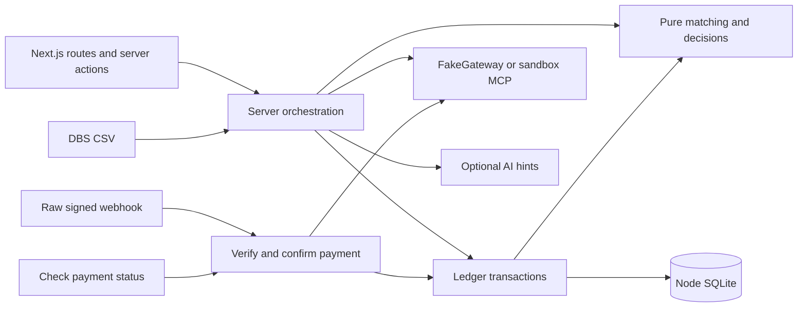

# Architecture

This is the current implementation. Product behavior belongs in [features](features.md), external contracts and configuration in [integrations](integrations.md), and checks and gaps in [verification](verification.md).

## Runtime and module ownership

Tally is one Next.js 15 App Router application with React 19 and strict TypeScript. It runs as a Node process with a local SQLite file using `node:sqlite` `DatabaseSync`. There is no ORM, libSQL client, Turso connection or implemented Vercel persistence setup.

| Path | Responsibility |
| --- | --- |
| [`src/app/`](../src/app/) | Routes, server actions, API handlers, loading/error boundaries |
| [`src/components/`](../src/components/), [`src/hooks/`](../src/hooks/), [`src/lib/`](../src/lib/) | UI, theme/sidebar behavior, hooks and shared helpers |
| [`src/domain/`](../src/domain/) | Pure money, dates, matching, decisions, types, allocation edges and invariant checkers; no I/O, ambient clock or randomness |
| [`src/server/flow.ts`](../src/server/flow.ts) | Import/match orchestration, hints, remainder requests and hold approval |
| [`src/server/ledger.ts`](../src/server/ledger.ts) | Business persistence, snapshots/projections, audit, settlement receipts, hint cache and demo bootstrap |
| [`src/server/db.ts`](../src/server/db.ts) | SQLite connection, schema/additive migrations and `withTx` |
| [`src/server/views.ts`](../src/server/views.ts), [`dashboard.ts`](../src/server/dashboard.ts) | Read models for the screens |
| [`src/server/env.ts`](../src/server/env.ts) | Application environment access and runtime guards |
| [`src/server/policy.ts`](../src/server/policy.ts), [`local-policy-access.ts`](../src/server/local-policy-access.ts) | Settings service and trusted local request checks |
| [`src/server/import/`](../src/server/import/), [`hitpay/`](../src/server/hitpay/), [`hints/`](../src/server/hints/) | Integration boundaries |
| [`tests/`](../tests/), [`fixtures/`](../fixtures/) | Tests grouped by responsibility; fictional bank/webhook inputs |
| [`scripts/`](../scripts/), [`spike/`](../spike/) | Operational commands and standalone signature/tamper exercise |

The `@/*` alias resolves to `src/*` in TypeScript and Vitest. Screens do not write SQL. Within the application, SQL writes are confined to `ledger.ts` and database initialization in `db.ts`; scripts may initialize/reset a database explicitly.

## Data and transactions

[`run`](../src/server/ledger.ts) begins an immediate SQLite transaction, loads a snapshot, calls the pure [`decide`](../src/domain/decide.ts), applies its follow-up commands and persists the resulting state, projections and audit together. Rejections roll back; storage failures throw and roll back. Domain functions receive policy date/time explicitly from the snapshot or caller.

Gateway calls happen outside these database transactions. Creating a request first commits a local `creating` row, calls the gateway, then records the returned ID/URL as `pending`. A failed gateway call can leave a `creating` row. It blocks duplicate creation for that obligation and is displayed with its reference; safe provider reconciliation remains a [known limitation](verification.md#known-limitations).

[`commitWebhook`](../src/server/ledger.ts) persists a receipt and its settlement changes atomically. Applied settlements and receipts that created review credits deduplicate by HitPay request ID across webhook and polling paths. Identical rejection evidence deduplicates; corrected confirmations and earlier nonterminal outcomes may be retried. Replay protection prevents a second ledger effect; the webhook handler can still make a remote confirmation call before deduplication.

Invoice and delivery creation run through `create_invoice`/`create_delivery`, with server/domain validation and atomic creation/audit. Invoice references follow `INV-` plus 3–6 digits; delivery references follow `DLV-` plus 3–9 digits. Identical repeated input returns the existing record; conflicting facts for an existing reference reject without writes. New records are inserted into the existing tables without a schema migration. Delivery creation does not queue policy evaluation or gateway calls. Detail decisions carry an expected delivery ID checked inside the ledger transaction, preventing stale forms from deciding a different hold. Explicit human evaluation is audited, and new proposal evidence includes policy date/version/settings.

The ledger also owns `hint_cache` writes. These are presentation cache updates, not financial commands or independently audited money transitions.

| Tables | Stored responsibility |
| --- | --- |
| `customer`, `customer_alias` | Customer hold and confirmed payer aliases |
| `invoice`, `write_off` | Invoice facts, balance projections and explicit write-offs |
| `bank_credit`, `suggestion`, `allocation` | Imported/settled credit, candidate groups and approval history |
| `delivery`, `payment_request` | Delivery state, payment purpose, reference, amount and gateway ID/URL |
| `settings` | Singleton numeric overdue policy and optimistic `policy_version` |
| `webhook_receipt` | Settlement source, dedupe key, outcome and raw-body hash |
| `audit_event` | Actor, timestamp, entity/action, before/after and evidence |
| `hint_cache`, `meta` | Cached reference insights and sequence state |

The [schema](../src/server/db.ts) has conservation/nonnegative constraints on invoice projections, positive allocations, unique payment references/HitPay IDs and unique credit dedupe keys. Triggers reject updates/deletes to `audit_event`. Additive initialization supports nullable `invoice.due_on`, policy-version and receipt-source columns and hint cache. Existing invoices migrate with unknown due dates, preserving historical financial data and audit. These checks complement domain validation; they do not prove the entire business history is valid.

## Database selection and initialization

`TALLY_DB_URL` defaults to `file:./data/tally.db`. `env.ts` strips the `file:` prefix; relative paths resolve against the working directory. `:memory:` is supported for tests. Other database URL schemes and a Turso auth token are not implemented.

`getDb()` caches one connection per process. On first use it opens/initializes the schema and calls `bootstrap()`. If there are no customers, bootstrap installs the fixed fictional demo world; it does not rebuild an existing customer ledger. Consequently the app, health route, doctor and dump command can initialize a new database if pointed at a nonexistent/empty path. Check the intended file before using them. Changing the database or gateway configuration requires restarting the process.

Runtime data stays in ignored `data/`; representative inputs stay in `fixtures/`. Logs, temporary ledgers and dumps belong in ignored `artifacts/`. `evidence/` is also ignored; local screenshots are optional and are not required to run the app.

## Routes and request flow

| Route | Purpose |
| --- | --- |
| `/`, `/import`, `/review` | Overview, DBS upload and match review |
| `/deliveries`, `/deliveries/[id]` | Policy-date delivery queue and supplier decision/evidence screen |
| `/invoice/new`, `/deliveries/new` | Guarded invoice/delivery entry for existing customers |
| `/customer`, `/customer/[id]`, `/invoice/[id]` | Balances, delivery decisions and invoice collection |
| `/settings`, `/audit` | Numeric overdue policy and recorded activity |
| `/driver/[deliveryId]`, `/pay/fake/[id]` | Driver status/checkout and explicitly simulated payment |
| `GET /api/health` | Selected database path and invoice count |
| `GET /api/delivery/[id]` | Local driver status |
| `POST /api/payment-request/[id]/status` | Gateway reconciliation; may write settlement state |
| `POST /api/hitpay/webhook` | Raw-body payment notice verification and settlement |
| `POST /api/hints` | Fill missing review explanations/cache |

The driver refreshes local delivery status every two seconds and checks a linked payment with the gateway every five seconds until a terminal outcome. A manual status button is also available. Payment polling is a mutation path, not merely a local read.

Normal `npm run dev` uses the custom [`dev-local.ts`](../scripts/dev-local.ts) launcher, binding `127.0.0.1:43123`, rejecting foreign Host and forwarded/proxy headers, and recording socket context with AsyncLocalStorage. These request guards are unchanged. Settings, [supplier mutations](features.md#supplier-entry-and-access), fake simulation and payment-poll/hints POST routes require development mode and exact `TALLY_LOCAL_LEDGER_EDITS=on` (also enabled by `npm run dev:supplier-demo`), trusted loopback local/peer sockets and same-origin POST. Settings additionally requires the [declared disposable-ledger gate](features.md#settings), explicit sandbox environment and explicit fake or MCP mode; sandbox credentials and `PUBLIC_URL` do not lock Settings or grant network access. `dev:policy-demo` is only an ordinary-dev compatibility alias, not an opt-in or bypass. Plain Next.js does not supply the trusted context. Keep this unauthenticated server on loopback, without proxying or tunnelling. Signed remote webhooks retain their own raw-signature/remote-confirmation boundary. Static human audit attribution is not authentication.
